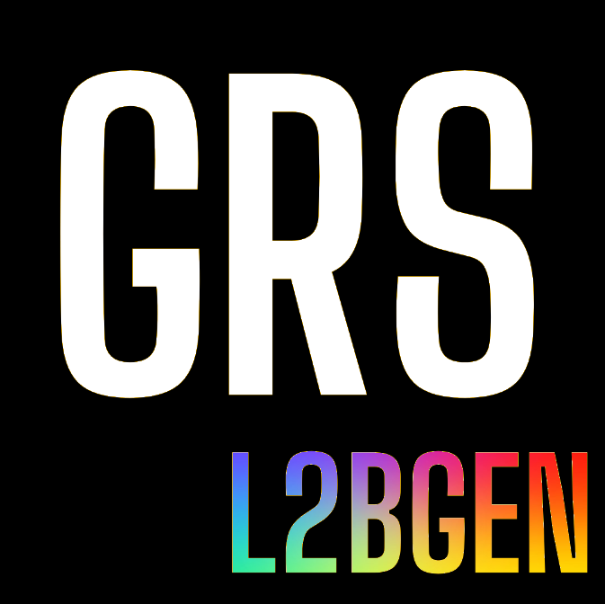
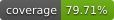
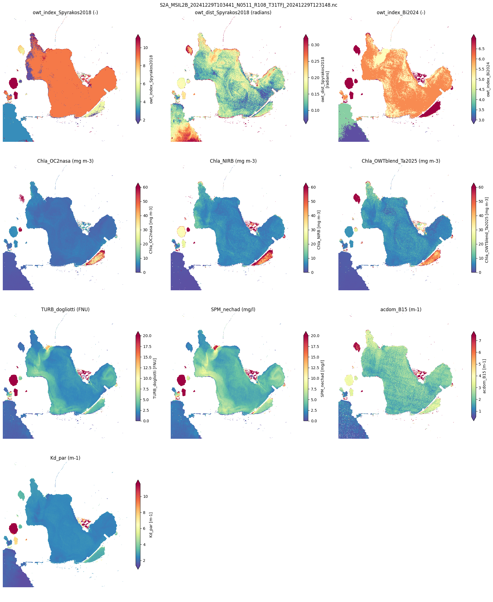

# GRSl2bgen
[](https://www.python.org/)
[](https://opensource.org/license/Apache-2.0)
[](https://github.com/CNES/GRSl2bgen/actions)

[](https://grsl2bgen.readthedocs.io/en/latest/)
[](https://hub.docker.com/r/guillaumeeb/l2bgen)
[](https://pypi.org/project/GRSl2bgen/)

**Scientific processor deriving water quality parameters from GRS Level-2A remote sensing reflectance (Rrs) images.**

📖 Full documentation: **<https://grsl2bgen.readthedocs.io>**

## Overview

GRSl2bgen takes one GRS Level-2A product (Rrs, produced by
[GRSprocessor](https://github.com/CNES/GRSprocessor)) and turns it into a single
Level-2B water quality product. For each granule (one tile, one date), it:

1. restricts the processing to valid water pixels (L2A `mask == 0`);
2. classifies every pixel into **Optical Water Types (OWT)** against three databases
   (Spyrakos et al. 2018, Bi et al. 2024, Tarasenko et al. 2025) with the Spectral Angle
   Mapper (or, optionally, the Euclidean distance);
3. retrieves **chlorophyll-a** (stand-alone algorithms and an OWT-blended product),
   **suspended particulate matter (SPM)** and **turbidity**, **colored dissolved organic
   matter (CDOM)** and **water transparency (Kd(PAR))**;
4. merges everything into one Level-2B product, written as **NetCDF** or **Zarr**
   (optionally as a multiscale Zarr pyramid for cloud visualisation).

The chain is lazy (dask): data are read and computed chunk by chunk when the output is
written, and the OWT classification runs on numba-compiled kernels.



## Level-2B variables

| Variable | Unit | Description |
|---|---|---|
| `owt_index_Spyrakos2018`, `owt_dist_Spyrakos2018` | –, rad | 3 best Spyrakos et al. (2018) classes and their spectral angles |
| `owt_index_Bi2024`, `owt_dist_Bi2024` | –, rad | Best Bi et al. (2024) class and its spectral angle |
| `owt_index_Ta2025`, `owt_dist_Ta2025` | –, rad | Best Tarasenko et al. (2025) class and its spectral angle |
| `Chla_OC2nasa`, `Chla_M09B`, `Chla_NIRB` | mg m⁻³ | Chlorophyll-a from NASA OC2, Moses et al. (2009) and the NIR-blue ratio |
| `Chla_OWTblend_Ta2025` | mg m⁻³ | OWT-blended chlorophyll-a (Tavares et al. 2025 recipe) |
| `SPM_nechad`, `SPM_obs2co` | mg L⁻¹ | Suspended particulate matter |
| `TURB_dogliotti` | FNU | Turbidity (Dogliotti et al. 2015) |
| `acdom_B15` | m⁻¹ | CDOM absorption at 440 nm (Brezonik et al. 2015) |
| `Kd_par` | m⁻¹ | Diffuse attenuation coefficient of PAR (Roy and Das 2022) |

The `flags` and `mask` variables of the input product are carried over. See the
[Output Product](https://grsl2bgen.readthedocs.io/en/latest/output_product.html) and
[Algorithm Description](https://grsl2bgen.readthedocs.io/en/latest/algorithms.html)
pages for the full product description and the equations of every retrieval.

## Installation

From PyPI:

```bash
pip install GRSl2bgen
```

From source (development install); installing the geospatial stack with conda first is
recommended:

```bash
conda install -c conda-forge rasterio xarray dask rioxarray
git clone https://github.com/CNES/GRSl2bgen.git
cd GRSl2bgen
pip install -e .
```

## Usage

### Command line

```
GRSl2bgen <input_file> [-o <ofile>] [--odir <odir>] [--pyramid] [--no_clobber]
```

`<input_file>` is a GRS L2A `.nc` file, a `.zarr` store, or a directory containing
`<name>.nc` and its `<name>_anc.nc` ancillary file. Process one L2A product into a NetCDF
L2B product:

```bash
img_dir=/your_path_for_image_folder
GRSl2bgen $img_dir/S2B_MSIL2Agrs_20220731T103629_N0400_R008_T31TFJ_20220731T124834.nc \
    -o $img_dir/L2B/S2B_MSIL2B_20220731T103629_N0400_R008_T31TFJ_20220731T124834.nc
```

- Without `-o`, the output is written to `--odir` (default: current directory) with
  `L2Agrs` replaced by `L2B` in the input file name.
- The output format follows the extension: `.zarr` gives a Zarr store, anything else
  NetCDF. Add `--pyramid` to a `.zarr` output to write a cloud-ready multiscale store.
- `--no_clobber` skips products that are already processed.

### Python

```python
from GRSl2bgen import Process

proc = Process(
    'S2B_MSIL2Agrs_20220731T103629_N0400_R008_T31TFJ_20220731T124834.nc',
    l2b_path='L2B/S2B_MSIL2B_20220731T103629_N0400_R008_T31TFJ_20220731T124834.nc',
    n_workers=4,          # local dask.distributed cluster (None: threaded scheduler)
    persist_input=True,   # keep the masked L2A raster in memory, read it once
)
proc.run()                # execute() + write_output() in the same dask context
```

## Tutorials

Executed Jupyter notebooks are available in the
[documentation](https://grsl2bgen.readthedocs.io/en/latest/):

- **Basics**: run the full processing chain and explore the L2B product; classify an
  image into OWT.
- **Advanced**: blend chlorophyll-a algorithms pixel by pixel from the OWT
  classification; define your own OWT from reference spectra.
- **Case studies**: process a multi-temporal datacube of GRS L2A images and evaluate the
  L2B time series against in situ measurements (Bagré reservoir).
- **Research**: regional custom OWT for the Loire estuary.

## Compile Docker image locally
First, you must get the Dockerfile out of the GRSl2bgen folder to have a structure as displayed below.

```
head_folder
 ├ GRSl2bgen
 └ Dockerfile
```

Note that anything in this folder tree will be added to the Docker build context, so make it light.
You might consider removing the notebooks and all useless files and directories from the GRSl2bgen
folder to make the resulting image as light as possible (.git, illustration, notebook...).

Once all those requirements are met, you can compile the Docker image using the following command:
```bash
docker build -t grsl2bgen:<version_tag> <path_to_head_folder> -f <path_to_Dockerfile>
```

When the compilation has ended, you can list the images with:
```bash
docker images
```

To run the Docker image in a container on a S2 raster you can use the `run_docker.sh` script as follows:
```bash
./run_docker.sh <image_ID> <L2A_raster_name> <L2A_raster_path> <desired_name_for_output> <desired_path_for_output>
```

## License

Apache License 2.0, see [LICENSE](LICENSE).
