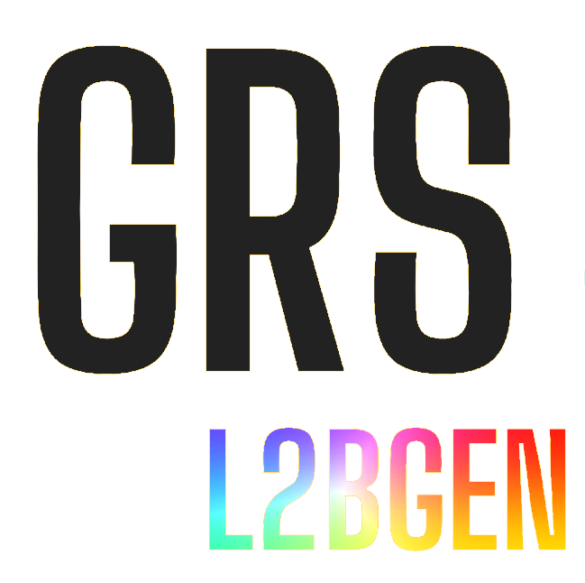

Processing Chain Description
=============================

This page documents GRSl2bgen following the
`Processing Chain Documentation Template <https://processing-chain-guidelines.readthedocs.io/en/latest/Data_processing_chain_template/>`_.

Process description
--------------------

Description
~~~~~~~~~~~

GRSl2bgen is a scientific processor that derives water-quality parameters from a GRS
Level-2A (Rrs, remote-sensing reflectance) product. Given one L2A product, it:

1. restricts the processing to valid water pixels (L2A ``mask == 0``);
2. checks the quality of the L2A reflectance: the SWIR module
   :math:`\sqrt{\Rrs(1610)^2 + \Rrs(2200)^2}`, which should be close to zero over water,
   is compared with three thresholds to flag residual glint, adjacency effect, thin
   cloud or mixed land/water pixels (:py:class:`GRSl2bgen.mask.QC_L2A`);
3. classifies every pixel into Optical Water Types (OWT) against three databases
   (Spyrakos et al. 2018, Bi et al. 2024, Tarasenko et al. 2025) with the Spectral Angle
   Mapper (or, optionally, the Euclidean distance), and against the SPM classes of
   Cordeiro (2022) with the Euclidean distance;
4. retrieves chlorophyll-a and suspended particulate matter (SPM), each with stand-alone
   algorithms and an OWT-blended product, turbidity, colored dissolved organic matter
   (CDOM, including two QAA v6 products that use the OWT-blended chlorophyll-a), and
   water transparency (Kd(PAR) and Secchi disk depth);
5. merges all of these into a single Level-2B product, written as NetCDF or Zarr
   (optionally as a multiscale Zarr pyramid for cloud visualisation). The L2A ``flags``
   and ``mask`` are copied unchanged; the flags set by GRSl2bgen (L2A quality control,
   retrieval warnings) are written to a separate bit field, ``flags_l2b``.

The equations of every retrieval are given in :doc:`algorithms`.

The processor is invoked through the ``GRSl2bgen`` command-line executable
(entry point ``GRSl2bgen.run:main``, see :py:mod:`GRSl2bgen.run`), which wraps the core
:py:class:`GRSl2bgen.process.Process` class.

Application Domain (Granule)
~~~~~~~~~~~~~~~~~~~~~~~~~~~~~

One processing run (one granule) corresponds to **one GRS Level-2A product for one
acquisition date and one tile/footprint**, read as a single ``.nc``/``.zarr`` file
(possibly a multiscale Zarr pyramid) or as a directory containing it (see
:py:class:`GRSl2bgen.product.Product` and `Inputs`_).

The output granule is a single Level-2B water-quality product (NetCDF, or Zarr when the
output path ends in ``.zarr``) covering the same footprint and resolution as the input L2A
product, or as the selected level of a Zarr pyramid input (``--level``).

Scheduling and Triggers
~~~~~~~~~~~~~~~~~~~~~~~~

GRSl2bgen has no built-in scheduler; it is triggered externally, granule by granule:

- **Interactively / single granule**: manual call to ``GRSl2bgen <input_file>`` or to
  :py:class:`GRSl2bgen.process.Process` from Python (see `Examples`_ below).
- **Containerized**: via the Docker image built from
  `Dockerfile <https://github.com/CNES/GRSl2bgen/blob/main/Dockerfile>`_ and run with
  `run_docker.sh <https://github.com/CNES/GRSl2bgen/blob/main/run_docker.sh>`_ (see
  :doc:`index` "Compile Docker image locally"). The image is built and published by the CI
  pipeline (GitLab ``kaniko_build`` job in ``.gitlab-ci.yml``, and the GitHub
  ``podman-build``/``pypi`` jobs in ``.github/workflows/main.yml``).

There is no periodicity of its own; scheduling (e.g. reprocessing on new GRS L2A outputs)
is delegated to the calling scripts/workflow.

Examples
~~~~~~~~

**Command line.** Process one L2A product into a NetCDF L2B product:

.. code-block:: bash

   img_dir=/your_path_for_image_folder
   GRSl2bgen $img_dir/S2B_MSIL2Agrs_20220731T103629_N0400_R008_T31TFJ_20220731T124834.nc \
       -o $img_dir/L2B/S2B_MSIL2B_20220731T103629_N0400_R008_T31TFJ_20220731T124834.nc

Without ``-o``, the output is written to ``--odir`` (default: current directory) as
``<input name>.nc``, with ``L2Agrs`` (any case, e.g. ``L2AGRS``) replaced by ``L2B``. Add
``--no_clobber`` to skip products that are already processed.

Process a coarser level of a Zarr pyramid input, e.g. for a quick look of the whole tile
(level ``k`` is ``2**k`` coarser than the full resolution, default ``0``):

.. code-block:: bash

   GRSl2bgen $img_dir/S2A_MSIL2AGRS_20170412T110621_N0500_R137_T30TWT_20231111T110836_V3.0.1dev \
       -o $img_dir/L2B/S2A_MSIL2B_20170412T110621_N0500_R137_T30TWT_level3.nc --level 3

Write a cloud-ready multiscale Zarr store instead (the format follows the output
extension; ``--pyramid`` is ignored for NetCDF):

.. code-block:: bash

   GRSl2bgen $img_dir/S2B_MSIL2Agrs_20220731T103629_N0400_R008_T31TFJ_20220731T124834.nc \
       -o $img_dir/L2B/S2B_MSIL2B_20220731T103629_N0400_R008_T31TFJ_20220731T124834.zarr --pyramid

**Python.** The same chain, run on a local dask cluster:

.. code-block:: python

   from GRSl2bgen import Process

   proc = Process(
       'S2B_MSIL2Agrs_20220731T103629_N0400_R008_T31TFJ_20220731T124834.nc',
       l2b_path='L2B/S2B_MSIL2B_20220731T103629_N0400_R008_T31TFJ_20220731T124834.nc',
       n_workers=4,          # local dask.distributed cluster (None: threaded scheduler)
       persist_input=True,   # keep the masked L2A raster in memory, read it once
       level=0,              # level read from a Zarr pyramid input (0: full resolution)
   )
   proc.run()                # execute() + write_output() in the same dask context

See the :doc:`tutorials/basics` notebooks for a quick look from a coarse pyramid level
and a full-resolution run (:doc:`tutorials/grsl2bgen_l2a_processing`), and the
:doc:`tutorials/advanced` notebooks for step-by-step examples of the OWT classification
and blending.

Dataflow
--------

.. mermaid:: _diagrams/dataflow.mmd

Inputs
------

.. list-table::
   :header-rows: 1
   :widths: 20 15 65

   * - Data Type Name
     - Cardinality
     - Selection Criteria
   * - GRS Level-2A product (``<input_file>``)
     - 1..1 (mandatory)
     - Water-leaving reflectance (Rrs) product produced by
       `GRSprocessor <https://github.com/CNES/GRSprocessor>`_, passed as the positional
       CLI argument: a ``.nc`` file, a ``.zarr`` store (possibly a multiscale pyramid, see
       below), or a directory ``<name>/`` containing ``<name>.zarr``, or ``<name>.nc``
       plus its ``<name>_anc.nc`` ancillary file.

**Zarr pyramid input.** A Zarr store whose root group has a ``multiscales`` attribute
(as written by GRS) is read as a pyramid: one group per resolution level (``0``, ``1``,
..., level ``k`` being ``2**k`` coarser) plus an ``ancillary`` group, for example

.. code-block:: text

   S2A_MSIL2AGRS_<...>_V3.0.1dev/
   └── S2A_MSIL2AGRS_<...>_V3.0.1dev.zarr/
       ├── 0/  1/  2/  3/  4/      # Rrs, mask, flags, sza, ... at each level
       └── ancillary/              # coarse ancillary data (yc, xc grid)

Only the group of the requested level (``--level`` on the command line, ``level`` of
:py:class:`~GRSl2bgen.process.Process` and :py:class:`~GRSl2bgen.product.Product`,
default ``0``) is read and processed; the L2B product has the grid of that level. A Zarr
store without ``multiscales`` is read as a single dataset.

Outputs
-------

.. list-table::
   :header-rows: 1
   :widths: 30 15 55

   * - Data Type Name
     - Cardinality
     - Description
   * - Level-2B water quality product (NetCDF or Zarr)
     - 1..1
     - Merged product (see :py:class:`GRSl2bgen.output.L2bProduct`), see the variable
       list below: the retrieved parameters, the ``flags``/``mask`` variables carried
       over from the input product and the GRSl2bgen flags ``flags_l2b`` (see
       `Data Types`_ below for naming).

The main variables are listed below; see :doc:`output_product` for the full
description (dimensions, attributes, quality flags, packing).

.. list-table:: Level-2B variables
   :header-rows: 1
   :widths: 35 15 50

   * - Variable
     - Unit
     - Description
   * - ``owt_index_Spyrakos2018``, ``owt_dist_Spyrakos2018``
     - --, rad
     - 3 best Spyrakos et al. (2018) classes (1-based) and their spectral angles,
       along the ``Nclasses`` dimension
   * - ``owt_index_Bi2024``, ``owt_dist_Bi2024``
     - --, rad
     - Best Bi et al. (2024) class and its spectral angle
   * - ``owt_index_Ta2025``, ``owt_dist_Ta2025``
     - --, rad
     - Best Tarasenko et al. (2025) class and its spectral angle
   * - ``owt_index_Cordeiro2022SPM``, ``owt_dist_Cordeiro2022SPM``
     - --, sr\ :sup:`-1`
     - 2 best Cordeiro (2022) SPM classes and their Euclidean distances, along the
       ``Nclasses`` dimension (shared with Spyrakos2018, the third entry is NaN)
   * - ``Chla_OC2nasa``, ``Chla_M09B``, ``Chla_NIRB``
     - mg m\ :sup:`-3`
     - Chlorophyll-a from NASA OC2, Moses et al. (2009) and the NIR-blue ratio
   * - ``Chla_OWTblend_Ta2025``
     - mg m\ :sup:`-3`
     - OWT-blended chlorophyll-a (Tavares et al. 2025 recipe)
   * - ``SPM_nechad``, ``SPM_obs2co``
     - mg L\ :sup:`-1`
     - Suspended particulate matter
   * - ``SPM_OWTblend_Ta2025``
     - mg L\ :sup:`-1`
     - OWT-blended suspended particulate matter (Cordeiro 2022 classes)
   * - ``TURB_dogliotti``
     - FNU
     - Turbidity (Dogliotti et al. 2015)
   * - ``acdom_B15``
     - m\ :sup:`-1`
     - CDOM absorption at 440 nm (Brezonik et al. 2015)
   * - ``adg443_QAAv6``
     - m\ :sup:`-1`
     - Detritus and CDOM absorption at 443 nm (QAA v6 adapted to MSI)
   * - ``adg443_QAAv6Chl``
     - m\ :sup:`-1`
     - Detritus and CDOM absorption at 443 nm (QAA v6 minus phytoplankton absorption
       from Chl-a)
   * - ``Kd_par``
     - m\ :sup:`-1`
     - Diffuse attenuation coefficient of PAR (Roy and Das 2022)
   * - ``Zsd_Lee15``
     - m
     - Secchi disk depth (Lee et al. 2015)
   * - ``flags``, ``mask``
     - --
     - L2A bit field (cloud, water, cirrus, ...) and binary mask (``0`` = processed
       water pixel), copied from the input product
   * - ``flags_l2b``
     - --
     - GRSl2bgen bit field: the SWIR module flags ``swir_module_low``/``medium``/``high``
       (bits 1-3, thresholds 0.002, 0.005 and 0.01 sr\ :sup:`-1` by default) and
       ``zsd_a_below_aw`` (bit 12), see :py:mod:`GRSl2bgen.mask`

Output formats
~~~~~~~~~~~~~~

The format follows the extension of the output path (see
:py:meth:`GRSl2bgen.output.L2bProduct.export`). In all formats the content and the
encoding are the same: continuous variables are packed into ``int16`` with a
per-variable ``scale_factor``/``add_offset`` and ``_FillValue = -32768`` (unpacked
automatically by ``xarray``), the OWT class numbers ``owt_index_*`` are stored as
``uint8`` with ``_FillValue = 0`` (class numbers start at 1), so that they read back as
exact integers, and ``flags``, ``flags_l2b`` and ``mask`` keep their own integer type.

.. list-table::
   :header-rows: 1
   :widths: 22 22 56

   * - Format
     - Selected by
     - Description
   * - NetCDF
     - any other extension (e.g. ``.nc``)
     - Single file, zlib compression (level 1 by default, ``complevel`` of :py:class:`~GRSl2bgen.process.Process`), NetCDF chunks aligned with the
       processing chunks (:py:meth:`~GRSl2bgen.output.L2bProduct.export_to_netcdf`).
   * - Zarr
     - ``.zarr``
     - Single-resolution store, regular chunks equal to the processing chunks
       (:py:meth:`~GRSl2bgen.output.L2bProduct.export_to_zarr`).
   * - Zarr pyramid
     - ``.zarr`` + ``--pyramid`` (CLI) or ``pyramid=True``
       (:py:class:`~GRSl2bgen.process.Process`)
     - Cloud-ready multiscale store
       (:py:meth:`~GRSl2bgen.output.L2bProduct.export_to_zarr_pyramid`), see below.
       ``--pyramid`` is ignored, with a warning, for NetCDF output.

Zarr pyramid export
^^^^^^^^^^^^^^^^^^^

The pyramid store holds the L2B product at several spatial resolutions, so that a web
viewer or a cloud client can display a whole tile quickly from a coarse level and fetch
full-resolution chunks only where it zooms in.

**Layout.** One Zarr group per resolution level, ``0`` being the full resolution and
each next level being 2 times coarser. Every level is a complete L2B dataset (same
variables, packing, CRS and ``spatial_ref``). The store is written in the Zarr format of
the installed zarr-python: format 3 with zarr-python 3 (below), format 2 with
zarr-python 2.x (``.zgroup``, ``.zattrs`` and ``.zmetadata`` instead of ``zarr.json``):

.. code-block:: text

   S2B_MSIL2B_<...>.zarr/
   ├── zarr.json        # product attributes, "multiscales" description and
   │                    # consolidated metadata of the whole hierarchy
   ├── 0/               # full resolution (e.g. 10980 x 10980 px at 10 m)
   ├── 1/               # 1/2  (5490 px, 20 m)
   ├── 2/               # 1/4  (2745 px, 40 m)
   ├── ...
   └── 5/               # 1/32 (343 px, 320 m)

**Number of levels.** Levels are added while the smaller image side of the next level
stays at least 256 pixels: a 10980-pixel Sentinel-2 tile at 10 m gives levels 0 to 5;
at 20 m (5490 pixels), levels 0 to 4.

**Resampling.** From one level to the next, each block of 2 x 2 pixels is reduced to
one pixel:

- continuous variables (Chl-a, SPM, OWT distances, ...): block average ignoring NaN,

  .. math::

     v^{(l+1)}_{i,j} = \operatorname{mean}_{\text{valid}}
     \left\{ v^{(l)}_{2i,2j},\ v^{(l)}_{2i+1,2j},\ v^{(l)}_{2i,2j+1},\ v^{(l)}_{2i+1,2j+1} \right\}

- categorical variables (``flags``, ``flags_l2b``, ``mask`` and the OWT class numbers
  ``owt_index_*``): nearest neighbour (top-left pixel of the block), which preserves the
  flag values and class numbers.

Edge pixels that do not fill a complete block are trimmed, so the origin of the grid is
unchanged and the pixel size doubles at every level; the ``GeoTransform`` of
``spatial_ref`` is updated accordingly. All levels use the packing parameters of level 0.

.. note::

   On coarse levels, ``owt_index_*`` is the class of one pixel of the block while
   ``owt_dist_*`` is the block average of the distances, so the two may refer to
   different pixels at class boundaries. Use level ``0`` for quantitative OWT analysis.

**Chunks.** 512 x 512 pixels at every level (or the whole level when it is smaller), a
good size for web access.

**Metadata.** The root group carries the product attributes and a ``multiscales``
attribute describing the levels (following the evolving Zarr *multiscales*
convention):

.. code-block:: json

   {
     "multiscales": {
       "layout": [
         {"asset": "0"},
         {"asset": "1", "derived_from": "0",
          "transform": {"scale": [2.0, 2.0]}, "resampling_method": "average"}
       ],
       "resampling_method": "average",
       "categorical_variables": ["owt_index_Spyrakos2018", "owt_index_Bi2024",
                                 "owt_index_Ta2025", "owt_index_Cordeiro2022SPM",
                                 "flags", "flags_l2b", "mask"],
       "categorical_resampling_method": "nearest",
       "dims": ["y", "x"]
     }
   }

The metadata of all groups are consolidated into the root metadata file (``zarr.json``,
or ``.zmetadata`` in format 2), so a client discovers the whole hierarchy with one
request.

**Performance.** The processing chain is evaluated only once, when level ``0`` is
written; each coarser level is computed from the level just written (read back from
the store), so the upstream processing is never repeated.

**Writing and reading.** From the command line:

.. code-block:: bash

   GRSl2bgen <L2A_input> -o <odir>/S2B_MSIL2B_<...>.zarr --pyramid

From Python, either through the processing chain or directly from an
:py:class:`~GRSl2bgen.output.L2bProduct` (to choose the number of levels, the minimum
size or the chunks):

.. code-block:: python

   import xarray as xr
   from GRSl2bgen import Process

   proc = Process(l2a_path, l2b_path='out/S2B_MSIL2B_<...>.zarr', pyramid=True)
   proc.run()

   # or, with custom settings, after proc.execute():
   # proc.l2b.export_to_zarr_pyramid('out/....zarr', min_size=512, chunks={'y': 256, 'x': 256})

   # read one level (the root group holds no data variables)
   full = xr.open_zarr('out/S2B_MSIL2B_<...>.zarr', group='0')
   overview = xr.open_zarr('out/S2B_MSIL2B_<...>.zarr', group='3')

Return Codes
------------

GRSl2bgen is a Python CLI (``docopt``-based). Unlike GRSprocessor, it does not configure a
dedicated file logger: log records go through the standard Python ``logging`` module at
``INFO`` level (see ``GRSl2bgen/__init__.py``), with no ``log_file.log``/``error.log`` written
to disk by default.

- ``0``: normal process exit, including the case where ``--no_clobber`` is set and the
  output file already exists (the granule is skipped after printing a message).
- Non-zero interpreter exit codes may occur for unhandled exceptions raised during
  processing (no top-level exception handler currently wraps :py:meth:`GRSl2bgen.process.Process.execute`),
  or for invalid CLI arguments rejected by ``docopt``.

Log Format
----------

No structured/file-based log format is currently defined; messages are emitted through the
root ``logging`` logger (``INFO`` level and above) and go to the console (stderr) by
default.

Required Resources
-------------------

No SLURM/HPC job scripts ship with this repository (unlike GRSprocessor). The needs depend
on the spatial resolution and size of the input product. For a full Sentinel-2 tile at
20 m (5490 x 5490 pixels), with the default settings, one run takes about **1.5 min and
6 GB of RAM** on a 40-core Intel Xeon Silver 4210 (see the profiling report in
``report/profiling/`` of the repository).

The chain is lazy (dask): :py:meth:`~GRSl2bgen.process.Process.execute` only builds the
computation graph, and the data are read and computed when the output is written. The
main settings are:

- ``spatial_chunk`` of :py:class:`GRSl2bgen.product.Product` (default 1024): the input is
  read with its stored chunks, then rechunked to 1024 x 1024 pixels along ``y``/``x`` and
  one chunk along ``wl``. The 256 x 256 chunks of the GRS products would make the dask
  graph about 7 times larger and the processing 2.6 times slower;
- ``n_threads`` of :py:class:`GRSl2bgen.process.Process` (default 8): threads of the dask
  threaded scheduler. More threads hardly run faster (most of the time is spent holding
  the Python GIL or writing the NetCDF file) but use more memory;
- ``persist_output`` (default True): the L2B product is computed once and kept in
  memory before it is written, instead of evaluating the chain twice (once for the int16
  packing ranges, once to write the file), at the cost of a few GB of RAM;
- ``n_workers`` / ``threads_per_worker``: run on a local ``dask.distributed`` cluster
  instead of the threaded scheduler;
- ``persist_input``: keep the water-masked input raster in memory (needs RAM for the
  masked raster);
- ``chunk`` of :py:class:`GRSl2bgen.owt.OWT_process`: spatial chunk size of the OWT
  classification, computed by numba-compiled kernels (``Nproc`` is deprecated and unused).

.. list-table::
   :header-rows: 1
   :widths: 30 30 40

   * - Resource Type
     - Quantity
     - Source / notes
   * - Disk — input
     - size of one GRS L2A product (netCDF/Zarr, plus ancillary file if any)
     - depends on sensor/resolution
   * - Disk — output
     - one Level-2B product, continuous variables packed as ``int16`` (NetCDF: zlib
       compression, level 1 by default; Zarr: optionally with pyramid levels)
     - written to ``-o``/``--odir`` (see :py:meth:`GRSl2bgen.output.L2bProduct.export`)

Data Types
----------

.. list-table::
   :header-rows: 1
   :widths: 18 32 15 35

   * - Data Name
     - Description
     - Granule
     - Nomenclature
   * - GRS Level-2A input product
     - Water-leaving reflectance (Rrs) product from GRSprocessor
     - one tile, one date
     - e.g. ``S2B_MSIL2Agrs_<datetime>_N<baseline>_R<orbit>_T<tile>_<datetime>.nc``
   * - Level-2B output product
     - NetCDF or Zarr water-quality product (OWT, chlorophyll-a, SPM, CDOM, transparency,
       quality flags)
     - one tile, one date
     - input basename with ``L2Agrs`` replaced by ``L2B``, e.g.
       ``S2B_MSIL2B_<datetime>_N<baseline>_R<orbit>_T<tile>_<datetime>.nc`` (see
       :py:func:`GRSl2bgen.run.main`)
